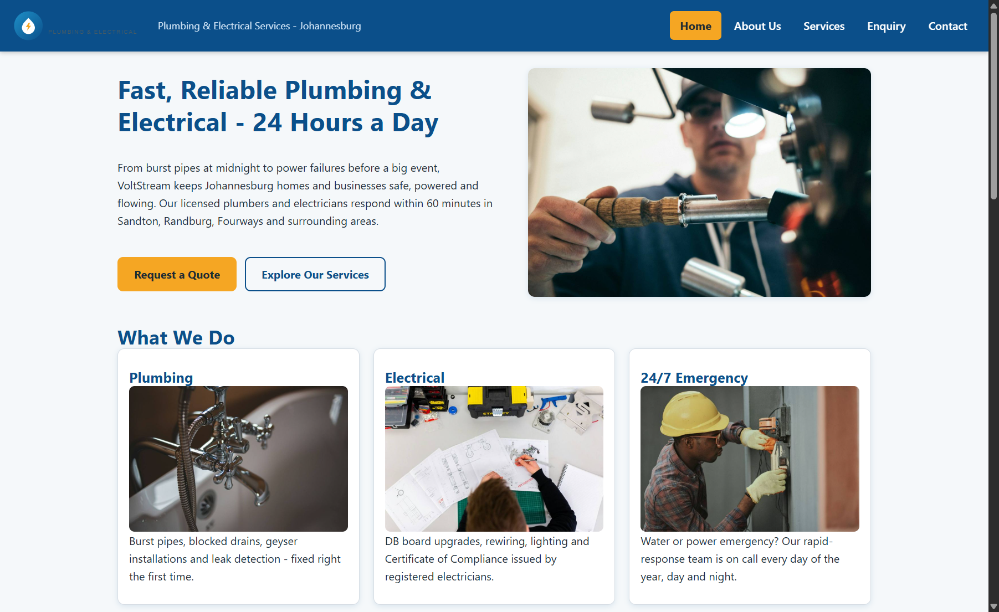
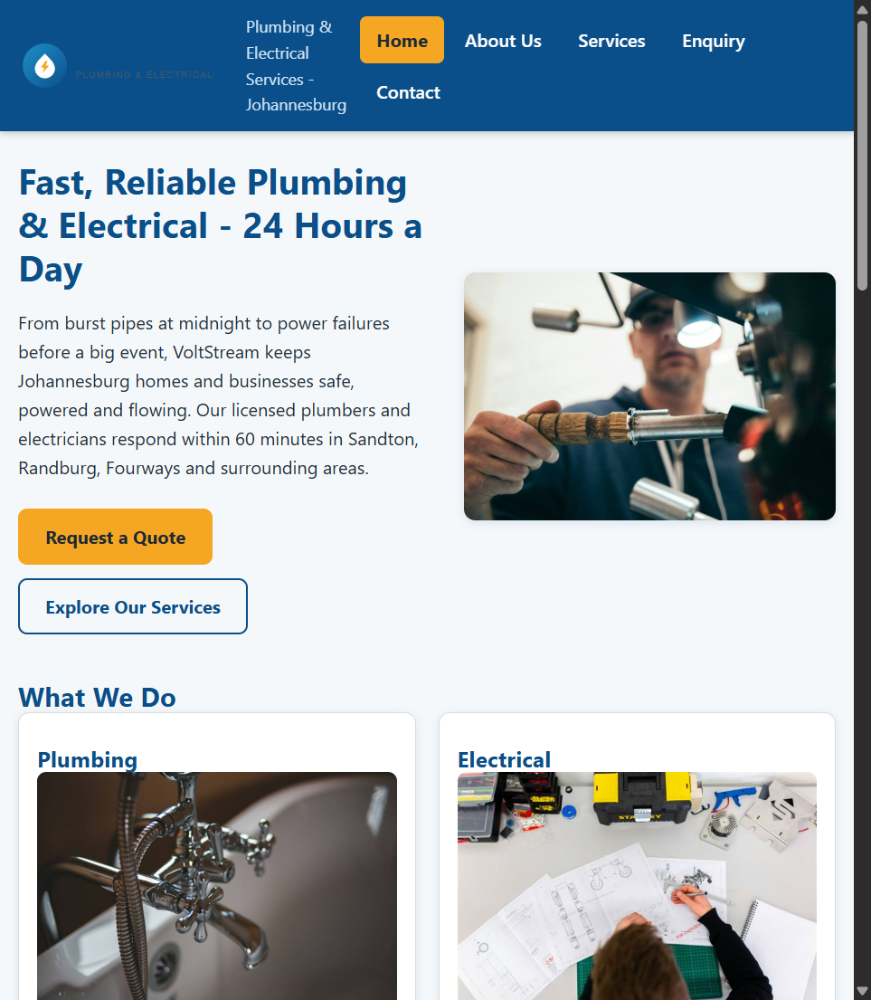
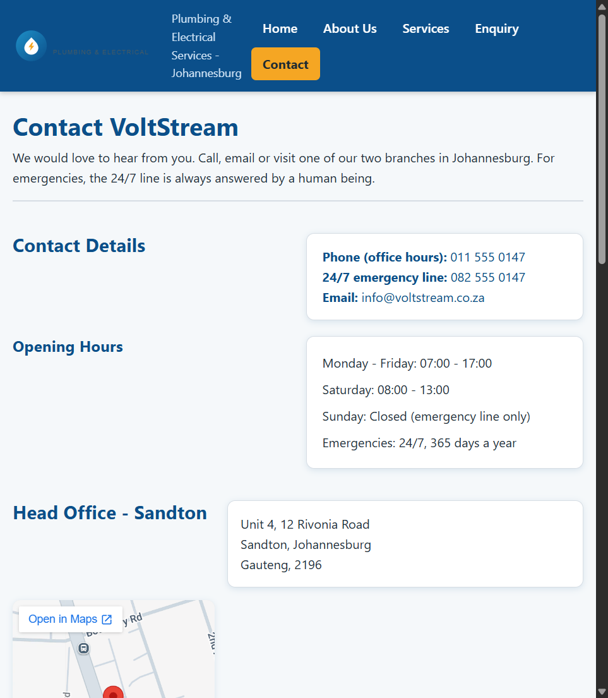
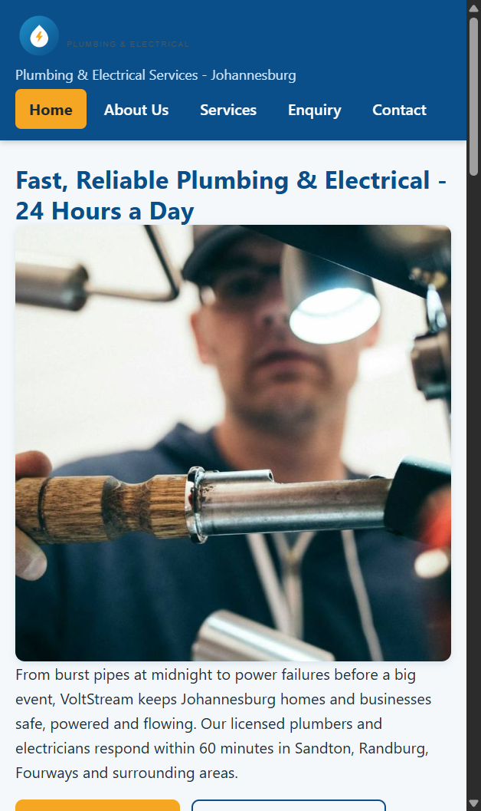
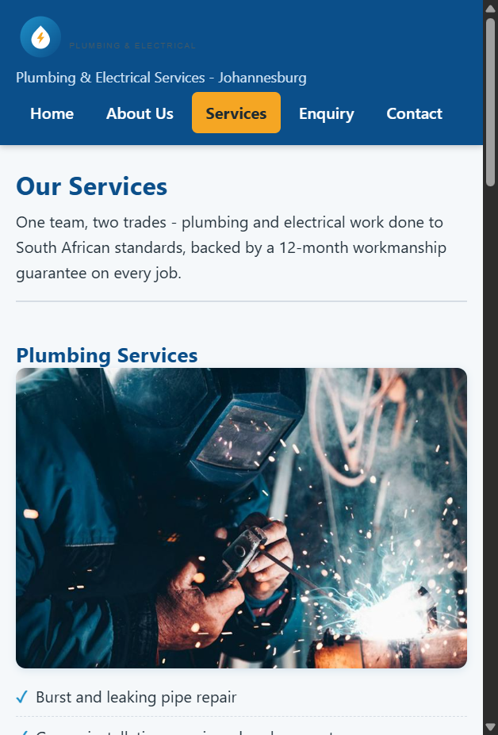
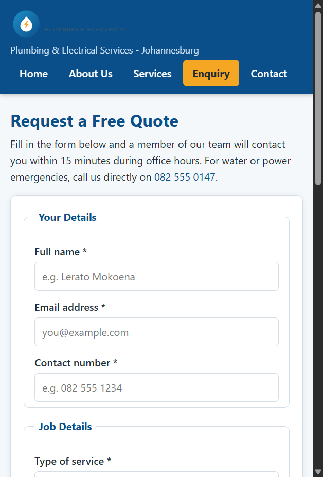
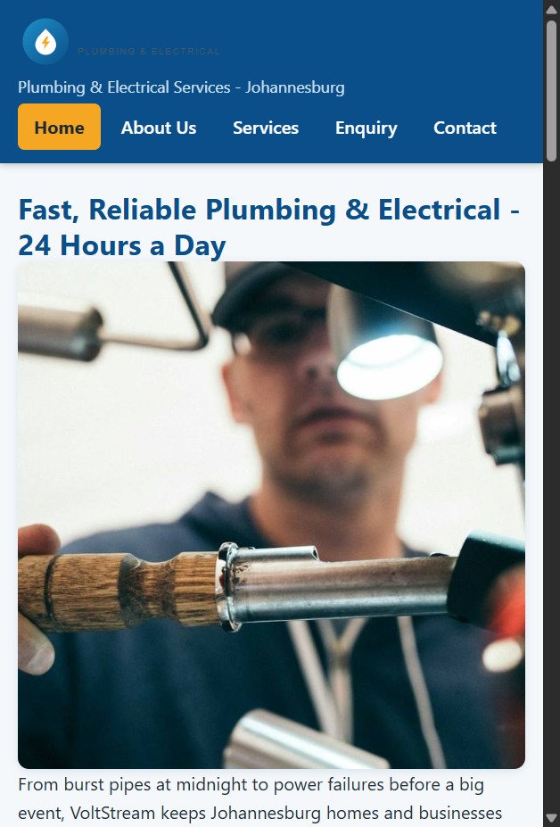

VoltStream Plumbing and Electrical - Company Website

WEDE5020 - Web Development (Introduction) - Portfolio of Evidence

Student Information

Full name: Basim Ubaid Akhtar
Student number: ST10516576
Institution: The Independent Institute of Education (IIE)

GitHub Repository

Link: https://github.com/basimakhtar/WEDE5020-PoE

This repository is on a personal GitHub account because the school's repository invitation link had expired and could not be used.

Project Overview

This project is a multi-page website for VoltStream Plumbing and Electrical (Pty) Ltd, a small plumbing and electrical business in Johannesburg. Two proposals were written, one for VoltStream and one for Paws of Hope Animal Shelter, and VoltStream was chosen as the organisation to build for.

Part 1: the planning, the research and the HTML structure of the site.
Part 2: the CSS styling and responsive design.
Part 3 (this submission): the JavaScript functionality, the SEO work and the deployment.

The site is deployed on GitHub Pages and can be visited at:

https://basimakhtar.github.io/WEDE5020-PoE/

Website Goals and Objectives

- 20 or more quote requests a month by month 3.
- 60% of enquiries turning into bookings.
- 10 or more emergency call-outs a month from the website.
- First-page Google results for five local search terms by December 2026.
- Home page bounce rate under 45%.

Key Features and Functionality

- Five linked HTML pages with one shared navigation menu.
- Semantic HTML5 with comments throughout.
- An external stylesheet (css/styles.css) shared by every page.
- A CSS reset, base styles, a typography scale and the brand colours as custom properties.
- Flexbox and grid layouts with a mobile-first, single-column layout that widens on bigger screens (MDN Web Docs, 2026).
- Interactive states on links, buttons, cards and form fields (:hover, :focus, :active).
- Responsive images: srcset and sizes attributes on every photo, and a picture element with a square crop for the hero on phones (MDN Web Docs, 2026).
- SEO groundwork: meta descriptions, page titles and alt text.
- A quote enquiry form and a quick contact form.
- Two branch locations, each with an embedded Google Map.
- Original SVG logo and avatars, web-optimised photos under the Unsplash License.
- Git version control with descriptive commits and a changelog.

Part 3 features:

- A recent-work gallery on the home page with filter buttons (All, Plumbing, Electrical) and a lightbox that opens photos full size with keyboard support (MDN Web Docs, 2026).
- Testimonials, the gallery and the FAQ list are rendered dynamically from js/data.js with JavaScript.
- Tabs on the about page (History, Mission and Vision, Values) with arrow-key navigation, and team member cards that open a modal with the full bio.
- A live search filter on the services page and a one-at-a-time FAQ accordion.
- Interactive Leaflet maps with OpenStreetMap tiles on the contact page, one marker and popup per branch (Leaflet, 2026).
- Scroll-reveal animations, a sticky header shadow, a back-to-top button and an automatic year in the footer.
- Full JavaScript validation on both forms: name, email format, South African phone number format, message length, past-date check and consent, with error notes next to each field (Mozilla Developer Network, 2026).
- The enquiry form submits with fetch() to js/quotes.json and shows the visitor an estimate and an availability note without reloading the page.
- The contact form compiles the message into an email addressed to info@voltstream.co.za and hands it to the visitor's mail app.
- On-page SEO: canonical links, Open Graph and Twitter cards, JSON-LD LocalBusiness structured data on the home page, lazy images and deferred scripts (Google Search Central, 2026).
- robots.txt and sitemap.xml added for search engine crawlers.

Timeline and Milestones

28 August 2026: proposals handed in.
4 September 2026: Part 1 due.
25 September 2026: Part 2 due.
30 October 2026: Part 3 due.
6 November 2026: final website submitted.

Part 1 Details

Folder structure:

index.html, about.html, services.html, enquiry.html, contact.html
css/styles.css - the shared stylesheet
js/main.js - all the JavaScript behaviour, loaded with defer
js/data.js - gallery, testimonial, team bio and FAQ content
js/quotes.json - the pricing estimates used by the enquiry form
images/ - photos, logo and team avatars
docs/ - proposals, wireframes, content inventory and screenshots
robots.txt and sitemap.xml - for search engine crawlers
Content-Research-Part1.zip - the Part 1 submission package

Sitemap

The visual sitemap below was added after the Part 1 feedback noted that no sitemap was provided.

Text version:

index.html (Home)
    about.html (About Us)
    services.html (Services)
    enquiry.html (Enquiry)
    contact.html (Contact)

Part 2 Details

What was added in this part:

1. External stylesheet

All five pages share one stylesheet, css/styles.css, linked in the head of each page. The file is organised into numbered sections: reset, variables, base styles, header, hero, buttons, cards, split sections, testimonials, CTA banner, team, chips, table, branches, forms and footer.

2. Base styles and CSS reset

The reset at the top of the stylesheet removes browser defaults (box-sizing, margins, list bullets, image gaps) so every browser starts from the same place (MDN Web Docs, 2026). The base styles then set the font family, font size, line height, colours, link colours and heading sizes once on the body and the headings, and everything inherits from there.

3. Typography

Headings use clamp() with rem units, so they scale smoothly between phones and desktops instead of jumping at a breakpoint. letter-spacing and line-height are set on headings for readability.

4. Layout with flexbox and grid

The header uses flexbox to keep the logo, tagline and navigation in a row on larger screens. The hero, service cards, team members and footer use CSS Grid. The hero uses grid-template-areas so the heading, text and buttons sit next to the photo. The cards switch from one column to two and then three columns as the screen gets wider (W3Schools, 2026).

5. Visual styles and interactive states

Cards, forms, tables and maps get borders, background colours, border-radius and box-shadows. Links, buttons, cards and form fields all have :hover, :focus and :active states, and keyboard users get a visible amber :focus-visible outline.

6. Responsive design

The layout is mobile-first: one column by default, then two media queries widen it at 40em (tablet) and 64em (desktop). Font sizes and spacing use rem and em, widths use %, and the media queries use em so the breakpoints follow the user's font size setting (MDN Web Docs, 2026).

7. Responsive images

480px and 768px versions of every photo were generated, plus an 800px square crop of the hero. Every content image now has srcset and sizes, so a phone downloads a 480px photo and a desktop downloads the full 1400px photo. The hero uses a picture element with a media query, so phones get the square crop instead of the wide shot (MDN Web Docs, 2026).

8. Testing

Every page was tested in Chrome DevTools at desktop, tablet and two phone sizes. No layout breaks or horizontal scrolling were found, and the network tab confirmed the correct image size loads at each breakpoint.

Screenshot evidence:

Desktop (1440 x 900):

Tablet (768 x 1024):

Mobile (iPhone 12, 390 x 844):

Mobile (Samsung Galaxy S8, 360 x 740):

Part 3 Details

What was added in this part:

1. JavaScript behaviour

All the interactivity lives in js/main.js, with the content for the gallery, testimonials, team bios and FAQ in js/data.js. Plain modern JavaScript was chosen instead of jQuery: the site is small and static, and native APIs keep the page lighter, which feeds into the page-speed requirement (MDN Web Docs, 2026). The script loads with defer so it never blocks rendering.

2. Interactive elements

The home page has a recent-work gallery rendered from data. Filter buttons narrow it to plumbing or electrical jobs, and clicking a photo opens a lightbox with previous and next controls and Escape and arrow-key support. On the about page the company story is split into tabs, and each team card opens a modal with the member's full bio. The services page has a search box that filters both service lists live and shows a note when nothing matches, plus a FAQ accordion built from data.js where opening one question closes the others.

3. Interactive maps

The two Google Maps iframes were replaced with Leaflet maps using OpenStreetMap tiles (Leaflet, 2026). Each branch gets its own map with a marker and an open popup showing the name and address. Leaflet was chosen because it needs no API key and its tiles are free with attribution.

4. Animations and DOM manipulation

Sections fade up as they scroll into view with an IntersectionObserver. The header gains a deeper shadow once the page scrolls, a back-to-top button is created and injected by JavaScript, and the footer year updates itself. The gallery, testimonials and FAQ are all built in the DOM at runtime from data.js.

5. Form validation

Both forms use novalidate so the browser's default bubbles are replaced with proper messages next to each field. Validation covers required fields, name characters, email format, a South African phone number pattern (0XX XXX XXXX or +27XXXXXXXXX), minimum message lengths, a past-date check on the preferred date, and the consent checkbox (MDN Web Docs, 2026).

6. Form processing

The enquiry form submits with fetch() to js/quotes.json. The response is used to build a card that thanks the visitor, gives a realistic cost estimate for their service type and an availability note, and offers the emergency number. The contact form validates the same personal fields, then compiles the message and opens the visitor's mail app with an email addressed to info@voltstream.co.za, which is the recipient stated in the code.

7. SEO work

Each page now has a canonical link, Open Graph and Twitter card tags, and the home page carries JSON-LD LocalBusiness structured data with the address, phone, email and opening hours (Schema.org, 2026). Below-the-fold images load lazily, scripts are deferred, and a robots.txt and sitemap.xml were added for crawlers (Google Search Central, 2026). Social links in the footer support the off-page plan: a Google Business Profile and Facebook and Instagram pages that link back to the site. Security measures taken: rel="noopener noreferrer" on external links, referrer policy on embedded content, output built with textContent instead of innerHTML so user input can never inject markup, and input checked before any use.

8. Deployment

The site is deployed on GitHub Pages (a free platform). It is served from the main branch of the repository and is live at:

https://basimakhtar.github.io/WEDE5020-PoE/

Part 1 Feedback Fixes

Two things from the Part 1 feedback were fixed in this part:

1. Sitemap was missing (0/5). A visual sitemap diagram has been added to this README under the Sitemap heading, showing all five pages and how they link together.

2. References needed in-text citations (2/5). In-text citations in the (Author, year) style now appear throughout this README and link to the reference list at the bottom.

Part 2 Feedback Fixes

The Part 2 marks came back with a 58% total (83 raw marks less a 25% deduction for AI usage). The criteria that lost marks have all been worked on in this part, and every change is recorded in the changelog below.

1. Responsive typography adjustments (0/5). The previous version only scaled the headings with clamp(). The root font size now steps up at the breakpoints: 100% on phones, 106.25% at 40em and 112.5% at 64em, so all rem-based text - body copy, navigation, forms, tables and footer - grows with the screen instead of staying one size (MDN Web Docs, 2026).

2. Pseudo-classes could be improved (7/10). More were added: ::selection and ::placeholder on text, :invalid and :valid border colours on filled-in text fields, :disabled on buttons while a form is processing, :last-child on the pricing table, ::before quote marks on testimonials, and :first-child, :not() and [aria-selected] selectors for the new tabs and accordion components.

3. References (2/5). The reference list has been expanded with the new sources used in this part (Leaflet, OpenStreetMap, Schema.org, Google Search Central, MDN JavaScript and Fetch pages), each with a full URL and access date, and in-text citations have been added throughout the Part 3 details above.

4. Feedback changes not clearly recorded (4/10 in the Part 1 feedback criterion). This README now spells out, criterion by criterion, what the feedback said, what changed and where it is recorded, and every edit from this part has a dated changelog entry below.

5. AI usage deduction. The writing in this README and the code comments were rewritten in plain language, shorter and less uniform, to read like a student's own notes.

Changelog

1 September 2026 - project structure created and the git repository initialised.
1 September 2026 - README, proposals, images and the five HTML pages added.
1 September 2026 - team names and avatars updated, proposals rewritten.
1 September 2026 - VoltStream confirmed as the chosen organisation.
1 September 2026 - the css and js files emptied.
1 September 2026 - README and content inventory simplified.
1 September 2026 - GitHub repository link and note added to the README.
5 October 2026 - added a visual sitemap diagram (docs/sitemap.svg) and in-text citations, after the Part 1 feedback on those two criteria.
5 October 2026 - wrote css/styles.css: CSS reset, base styles, typography scale and the brand colours as custom properties.
5 October 2026 - styled the header, navigation, hero, cards, testimonials, CTA banner, team, table, forms, maps and footer with flexbox and grid, including hover, focus and active states.
5 October 2026 - made the layout responsive with breakpoints at 40em and 64em, relative units (rem, em, %) and a mobile-first single-column layout.
5 October 2026 - generated 480px and 768px versions of every photo plus an 800px square hero crop, and added srcset, sizes and a picture element to the HTML.
5 October 2026 - tested all pages in Chrome DevTools at desktop, tablet and two phone sizes, and added the screenshot evidence to the README.
9 November 2026 - feedback fix: added responsive typography. The root font size now steps from 100% to 106.25% at 40em and 112.5% at 64em, so all rem-based text scales with the screen (fixes the 0/5 on responsive typography adjustments).
9 November 2026 - feedback fix: added more pseudo-classes. ::selection, ::placeholder, :invalid and :valid field borders, :disabled buttons, :last-child on the pricing table, ::before quote marks on testimonials, and the tab, accordion and modal state selectors (improves the 7/10 on pseudo-classes).
9 November 2026 - feedback fix: expanded the reference list with the Part 3 sources (Leaflet, OpenStreetMap, Schema.org, Google Search Central, MDN JavaScript and Fetch) and added in-text citations to the Part 3 details (fixes the 2/5 on references).
9 November 2026 - feedback fix: documented every feedback-based change, criterion by criterion, under Part 2 Feedback Fixes and in these changelog entries (fixes the 4/10 on acting on feedback).
9 November 2026 - added js/data.js with the gallery, testimonial, team bio and FAQ content, and js/quotes.json with the pricing estimates used by the enquiry form.
9 November 2026 - added js/main.js with the shared behaviour: header shadow, scroll-reveal animations, back-to-top button, footer year, gallery rendering with filters and a lightbox, testimonials, tabs, team modals, service search, FAQ accordion, Leaflet maps, and validation and processing for both forms.
9 November 2026 - replaced the two Google Maps iframes with interactive Leaflet maps using OpenStreetMap tiles, one marker and popup per branch.
9 November 2026 - rebuilt the enquiry form: JavaScript validation for every field, then an AJAX fetch() to js/quotes.json that shows the visitor a cost estimate and availability note without a page reload.
9 November 2026 - rebuilt the contact form: validation, then the message is compiled into an email addressed to info@voltstream.co.za and opened in the visitor's mail app.
9 November 2026 - SEO pass: canonical links, Open Graph and Twitter cards, JSON-LD LocalBusiness data, lazy images, deferred scripts, robots.txt, sitemap.xml and social links in the footer.
9 November 2026 - deployed the site to GitHub Pages and verified all five pages at desktop and mobile widths in Chrome.

References

Images

Unsplash. 2026. Eight photographs used under the Unsplash License. Photo pages: photo-1558618666-fcd25c85cd64, photo-1621905251189-08b45d6a269e, photo-1585704032915-c3400ca199e7, photo-1581092160562-40aa08e78837, photo-1600585154340-be6161a56a0c, photo-1581091226825-a6a2a5aee158, photo-1503387762-592deb58ef4e, photo-1504328345606-18bbc8c9d7d1, all on https://unsplash.com. License terms: https://unsplash.com/license (Accessed 1 September 2026). The logo and the team avatars are original work by the student.

Code and techniques

Mozilla Developer Network (MDN) Web Docs. 2026. CSS: Cascading Style Sheets. Available at: https://developer.mozilla.org/en-US/docs/Web/CSS (Accessed 5 October 2026).

Mozilla Developer Network (MDN) Web Docs. 2026. Responsive images. Available at: https://developer.mozilla.org/en-US/docs/Web/HTML/Responsive_images (Accessed 5 October 2026).

Mozilla Developer Network (MDN) Web Docs. 2026. Media queries. Available at: https://developer.mozilla.org/en-US/docs/Web/CSS/CSS_media_queries (Accessed 5 October 2026).

Mozilla Developer Network (MDN) Web Docs. 2026. JavaScript: Dynamic client-side scripting. Available at: https://developer.mozilla.org/en-US/docs/Learn/JavaScript (Accessed 9 November 2026).

Mozilla Developer Network (MDN) Web Docs. 2026. Client-side form validation. Available at: https://developer.mozilla.org/en-US/docs/Learn/Forms/Form_validation (Accessed 9 November 2026).

Mozilla Developer Network (MDN) Web Docs. 2026. Using the Fetch API. Available at: https://developer.mozilla.org/en-US/docs/Web/API/Fetch_API/Using_Fetch (Accessed 9 November 2026).

W3Schools. 2026. CSS Tutorial. Available at: https://www.w3schools.com/css/ (Accessed 5 October 2026).

W3Schools. 2026. Responsive Web Design Tutorial. Available at: https://www.w3schools.com/css/css_rwd_intro.asp (Accessed 5 October 2026).

W3Schools. 2026. JavaScript Tutorial. Available at: https://www.w3schools.com/js/ (Accessed 9 November 2026).

Leaflet. 2026. Leaflet, an open-source JavaScript library for mobile-friendly interactive maps. Available at: https://leafletjs.com (Accessed 9 November 2026).

OpenStreetMap contributors. 2026. OpenStreetMap tile usage policy. Available at: https://operations.osmfoundation.org/policies/tiles/ (Accessed 9 November 2026).

Schema.org. 2026. LocalBusiness schema. Available at: https://schema.org/LocalBusiness (Accessed 9 November 2026).

Google Search Central. 2026. Introduction to robots.txt. Available at: https://developers.google.com/search/docs/crawling-indexing/robots/intro (Accessed 9 November 2026).

Google Search Central. 2026. Build and submit a sitemap. Available at: https://developers.google.com/search/docs/crawling-indexing/sitemaps/build-sitemap (Accessed 9 November 2026).

Google. 2026. Google Maps embed help. Available at: https://support.google.com/maps/answer/144361 (Accessed 1 September 2026).

Squoosh. 2026. Image compressor. Available at: https://squoosh.app (Accessed 1 September 2026).

Git. 2026. Git documentation. Available at: https://git-scm.com/doc (Accessed 1 September 2026).

GitHub. 2026. GitHub Pages documentation. Available at: https://docs.github.com/en/pages (Accessed 9 November 2026).
