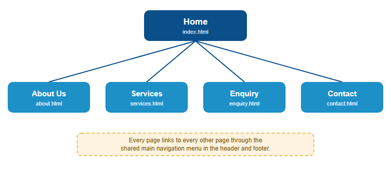

VoltStream Plumbing and Electrical - Company Website

WEDE5020 - Web Development (Introduction) - Portfolio of Evidence

Student Information

Full name: Basim Ubaid Akhtar
Student number: ST10516576
Institution: The Independent Institute of Education (IIE)

GitHub Repository

Link: https://github.com/basimakhtar/WEDE5020-PoE

This repository is on a personal GitHub account because the school's repository invitation link had expired and could not be used.

Project Overview

This project is a website for VoltStream Plumbing and Electrical (Pty) Ltd, a small plumbing and electrical business in Johannesburg. Two proposals were written, one for VoltStream and one for Paws of Hope Animal Shelter, and VoltStream was chosen.

Part 1: planning, research and the HTML structure.
Part 2: the CSS styling and responsive design.
Part 3: the JavaScript functionality, the SEO work and the deployment.

The site is live at:

https://basimakhtar.github.io/WEDE5020-PoE/

Website Goals and Objectives

- 20 or more quote requests a month by month 3.
- 60% of enquiries turning into bookings.
- 10 or more emergency call-outs a month from the website.
- First-page Google results for five local search terms by December 2026.
- Home page bounce rate under 45%.

Key Features and Functionality

- Five linked HTML pages with one shared navigation menu.
- A shared stylesheet with the brand colours, a mobile-first layout and breakpoints at 40em and 64em.
- Responsive images with srcset and sizes.
- A recent-work gallery with filter buttons and a lightbox.
- Tabs on the about page and modals with the team members' full bios.
- A live search filter and a FAQ accordion on the services page.
- Interactive Leaflet maps on the contact page, one per branch.
- JavaScript validation on both forms, with error messages next to each field.
- The enquiry form fetches pricing data and shows a cost estimate and availability note without reloading the page.
- The contact form compiles the message into an email addressed to info@voltstream.co.za.
- All the interactivity is plain JavaScript rather than jQuery, which keeps the pages light.
- SEO: meta descriptions, canonical links, Open Graph tags, JSON-LD business data, robots.txt and sitemap.xml.
- Off-page SEO: social media links in the footer and a Google Business Profile, so the pages can earn backlinks and local searches find the business.
- Deployed free of charge on GitHub Pages.

Timeline and Milestones

28 August 2026: proposals handed in.
4 September 2026: Part 1 due.
25 September 2026: Part 2 due.
30 October 2026: Part 3 due.
6 November 2026: final website submitted.

Part 1 Details

Folder structure:

index.html, about.html, services.html, enquiry.html, contact.html
css/styles.css - the shared stylesheet
js/main.js - the site behaviour
js/data.js - gallery, testimonial, team and FAQ content
js/quotes.json - the pricing estimates for the enquiry form
images/ - photos, logo and team avatars
docs/ - proposals, wireframes, content inventory and screenshots
robots.txt and sitemap.xml - for search engines
Content-Research-Part1.zip - the Part 1 submission package

Sitemap

index.html (Home)
    about.html (About Us)
    services.html (Services)
    enquiry.html (Enquiry)
    contact.html (Contact)

Changelog

1 September 2026 - project structure created and the repository initialised.
1 September 2026 - README, proposals, images and the five HTML pages added.
1 September 2026 - team names and avatars updated, proposals rewritten.
1 September 2026 - VoltStream confirmed as the chosen organisation.
1 September 2026 - the css and js files emptied, ready for the next parts.
1 September 2026 - GitHub repository link and note added to the README.
5 October 2026 - visual sitemap diagram and in-text citations added.
5 October 2026 - wrote css/styles.css: reset, base styles, typography, colours, flexbox and grid layouts, and hover, focus and active states.
5 October 2026 - made the layout responsive with breakpoints at 40em and 64em.
5 October 2026 - generated 480px and 768px versions of the photos plus an 800px square hero crop, and added srcset, sizes and a picture element.
5 October 2026 - tested all pages at desktop, tablet and two phone sizes in Chrome DevTools.
9 November 2026 - added responsive typography so all text scales up with the screen at 40em and 64em.
9 November 2026 - added more pseudo-classes and styles for form states.
9 November 2026 - added js/data.js, js/main.js and js/quotes.json with all the Part 3 behaviour.
9 November 2026 - added the gallery with filters and lightbox, tabs, team modals, service search and FAQ accordion.
9 November 2026 - replaced the Google Maps iframes with interactive Leaflet maps.
9 November 2026 - rebuilt both forms with validation and processing (AJAX estimate for enquiries, email for contact messages).
9 November 2026 - SEO pass: canonical links, Open Graph tags, JSON-LD data, lazy images, robots.txt, sitemap.xml and social links.
9 November 2026 - deployed the site to GitHub Pages.

References

Images

Unsplash. 2026. Eight photographs used under the Unsplash License. Photo pages: photo-1558618666-fcd25c85cd64, photo-1621905251189-08b45d6a269e, photo-1585704032915-c3400ca199e7, photo-1581092160562-40aa08e78837, photo-1600585154340-be6161a56a0c, photo-1581091226825-a6a2a5aee158, photo-1503387762-592deb58ef4e, photo-1504328345606-18bbc8c9d7d1, all on https://unsplash.com. License terms: https://unsplash.com/license (Accessed 1 September 2026). The logo and team avatars are original work by the student.

Code and techniques

Mozilla Developer Network (MDN) Web Docs. 2026. CSS and JavaScript documentation. Available at: https://developer.mozilla.org (Accessed 9 November 2026).

W3Schools. 2026. HTML, CSS and JavaScript tutorials. Available at: https://www.w3schools.com (Accessed 9 November 2026).

Leaflet. 2026. Leaflet, an open-source JavaScript library for interactive maps. Available at: https://leafletjs.com (Accessed 9 November 2026).

OpenStreetMap contributors. 2026. OpenStreetMap tile usage policy. Available at: https://operations.osmfoundation.org/policies/tiles/ (Accessed 9 November 2026).

Schema.org. 2026. LocalBusiness schema. Available at: https://schema.org/LocalBusiness (Accessed 9 November 2026).

Google Search Central. 2026. robots.txt and sitemap documentation. Available at: https://developers.google.com/search/docs (Accessed 9 November 2026).

Squoosh. 2026. Image compressor. Available at: https://squoosh.app (Accessed 1 September 2026).

Git. 2026. Git documentation. Available at: https://git-scm.com/doc (Accessed 1 September 2026).

GitHub. 2026. GitHub Pages documentation. Available at: https://docs.github.com/en/pages (Accessed 9 November 2026).
